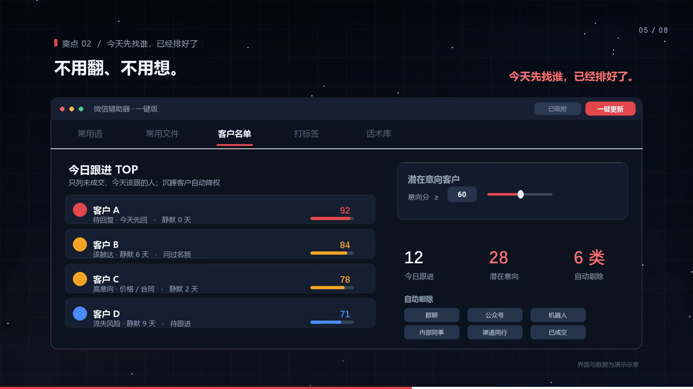

# 微信辅助器 · 一键版

> 给客服 / 销售用的 Windows 桌面小工具。**完整解压 → 双击「一键安装.bat」→ 点开就用。**
>
> [下载安装包与 20 秒宣传片](https://github.com/qin-zhipeng/baoyan-skills/releases/tag/v1.1.0) · [源码](../wechat-assistant/) · [安装说明](../wechat-assistant/INSTALL.md)



---

## 一句话

它把**你自己电脑上的微信聊天记录**变成三件东西：今天该先找谁、谁还有意向、哪些话术真的打赢过单子。

不用装 Python、不用配依赖、不用填密钥、不用联网。运行环境全部随包，所有名单和报告都在本机现算。

## 为什么做它

微信里几百个会话，没人告诉你今天先找谁——**漏跟、跟丢**；单子成了，也说不清到底赢在哪一句，下次只能**全凭感觉**；问候、发资料、打标签，一天敲上百遍，是**重复劳动**。

宣传片 8 个画面讲的就是这三件事，以及怎么把它们一次交出去：**「一键更新」之后，它自己跑完 6 步；你只点了一次。**

## 三步装好，之后只点一个按钮

1. **完整解压**到一个固定文件夹（`runtime/`、`bin/` 缺一不可，路径带中文、带空格都没问题）
2. **双击「一键安装.bat」**——检查运行环境、跑 96 项自检、建桌面快捷方式、自动启动
3. **桌面图标，点开就用**

首次接入只需显式同意一次：程序会重启微信，你在手机上点微信自己的「确认登录」，密钥缓存在本机；之后每次启动 / 点「一键更新」都完全无感。不想接入也能用常用语、常用文件、打标签。

## 「一键更新」按下之后，它自己跑完 6 步

```
① 定位微信主程序与数据目录（含自定义安装盘、多账号目录）
② 取本机数据库密钥（已有则 HMAC 校验复用）
③ 解密 SQLCipher 4 本地库，按会话归集成 jsonl
④ 出跟进名单：今日跟进 TOP / 潜在意向客户
⑤ 成交归因：异议应答、复用话术、阶段流失、成交周期
⑥ 自动填回软件：名单 + 两份 CSV + 核对清单 + Markdown 报告 + 话术库
```

## 五个页签，每个只做一件事

| 页签 | 点一下发生什么 |
| --- | --- |
| **常用语** | 文字自动进微信输入框 → **你点【发送】** |
| **常用文件** | 文件自动进微信输入框 → **你点【发送】** |
| **客户名单** | 自动出「今日跟进 TOP / 潜在意向客户」→ 勾人 → 送去打标签 |
| **打标签** | 自动勾选名单里的人；最后【完成】你自己点 |
| **话术库** | 看成交归因结果，把打赢过的话术一键存进常用语 |

### 客户名单：不用翻、不用想

- **今日跟进 TOP** 只列未成交、今天该跟的人，按「客户留言待回复 → 到点该主动触达 → 有流失风险 / 高意向 / 临门一脚」排序；静默超过 14 天的沉睡客户自动降权，每行开头直接写清「待回复 · 今天先回」「该触达 · 静默 6 天」。
- **潜在意向客户** 命中成交信号、未成交、未放弃，意向分阈值可调。
- **自动剔除** 群聊、公众号、机器人、服务号、内部同事、渠道同行，以及已成交 / 退费 / 明确放弃的人。
- 打分词典集中在 `core/chat_radar.py` 顶部，口径随你改。

### 话术库：把打赢过的话，变成下一次的一键

不猜、不编——每一句都来自**真实发出过、且那单最后成了**的会话：

- 异议 → 我的应答：按价格 / 拖延 / 对比 / 效果四类归集
- 跨会话复用话术 TOP：归一化聚类，统计在多少个成交单里用过，保留原句
- 成交链证据覆盖、六步阶段关卡流失、成交周期分布
- 成交客户主要从**你自己微信里的备注名 / 昵称 / 标签**识别，否定词优先、四档置信度、逐人可核对，不会被「付老师」「待付款」这类词误伤

## 隐私与边界（写死在代码里，没有开关）

- **只处理本机当前登录的微信账号**，不碰他人账号
- **数据不出本机**：不联网、不上传、无遥测；密钥、聊天记录、名单、报告全在本地
- **只读微信数据**，不改微信文件；关闭 / 重启微信前必须显式同意；不后台驻留
- 解密出的图片 / 语音 / 视频只保留类型标签，不还原媒体内容
- 常用语 / 常用文件默认**只进输入框不自动发送**；打标签**只勾选，绝不点【完成】**
- **包里不含任何聊天记录、客户名单、密钥或账号信息**，全部数据是装好后在自己电脑上现算的

> 导出内容含客户隐私，请自行妥善保管；使用前请确认已取得相关方同意，并遵守所在地法律法规与微信平台规则。

## 技术规格

| 项 | 说明 |
| --- | --- |
| 运行环境 | 自带 Python 3.13.1 (embeddable) + PySide6 6.12 + pycryptodome + zstandard |
| 微信版本 | Windows 微信 4.x（3.x 数据结构不同，不支持） |
| 解密 | SQLCipher 4：PBKDF2-HMAC-SHA512 256000 轮、AES-256-CBC、页级 HMAC 校验 |
| 消息内容 | ZSTD 压缩自动识别解压；媒体只留类型标签 |
| 数据格式 | `all_messages.jsonl`：`chat / chat_wxid / is_self / ts / type / content` |
| 自检 | `runtime\python.exe app.py --selftest`（96 项） |

## 下载与源码

| 文件 | 说明 |
| --- | --- |
| `微信辅助器_一键版_20261113.zip` | 完整安装包，约 31 MB，解压即用 |
| `微信辅助器_一键版_宣传片.mp4` | 20.2 秒 / 1920×1080 / H.264 + AAC / 约 4.6 MB，8 张画面讲完整个产品 |

两者都在 [Releases v1.1.0](https://github.com/qin-zhipeng/baoyan-skills/releases/tag/v1.1.0)。第一方源码在 [`wechat-assistant/`](../wechat-assistant/)，按 MIT 开源；随包的第三方二进制不进 git，清单与许可见 [THIRD-PARTY.md](../wechat-assistant/THIRD-PARTY.md)。

> **说明**：宣传片中的名单、分数、复用单数、进度条均为演示示意，不是实测成绩。密钥捕获组件会挂载登录监听，部分安全软件会误报；读取微信本地数据库的方式可能不符合微信平台规则，请自行评估使用风险。

---

相关：本仓库的 [`baoyan-deal-chat`](../baoyan-deal-chat/) 技能做的是同一条业务链的「AI 出稿」侧——读聊天记录、算优先级、写建议话术，发送永远由人点。这个桌面工具是它的**本机执行端**。
